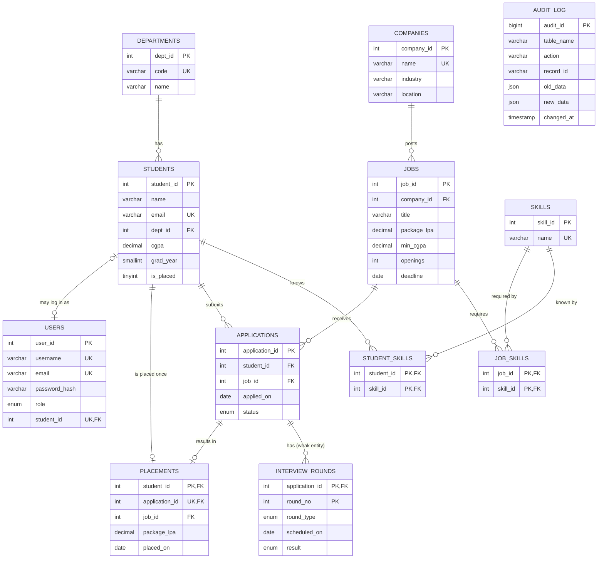
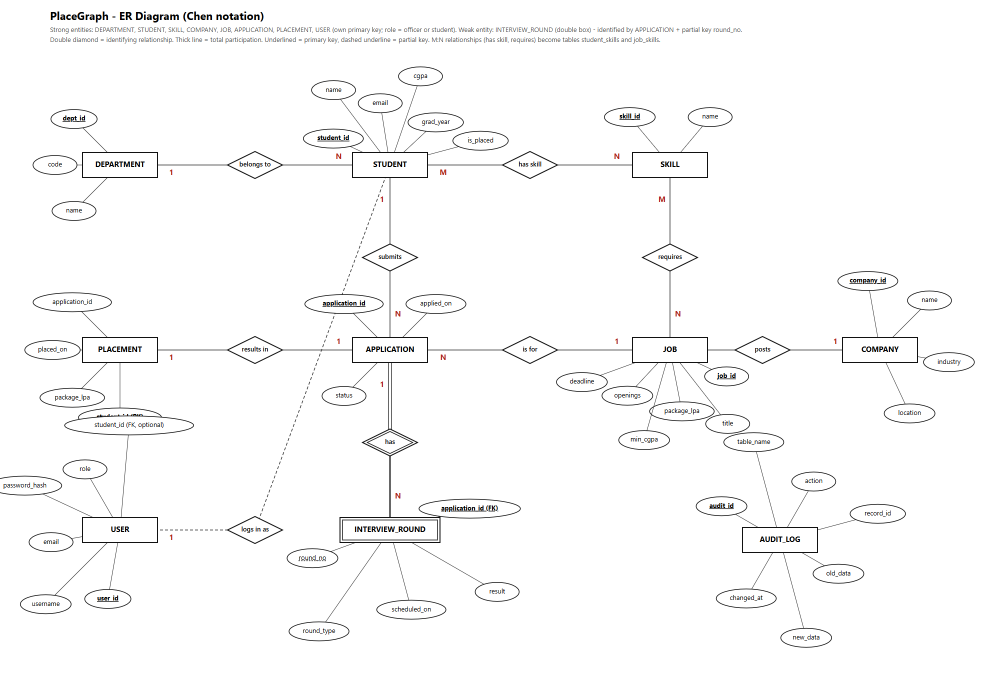

# The database schema, explained simply

PlaceGraph keeps its facts in **MySQL** (12 tables) and copies a "who is connected to what" picture into **Neo4j**. This guide explains the MySQL tables first, then the graph.

Pictures to print or show: [ER diagram (PDF)](er_diagram.pdf) and [relational schema (PDF)](relational_schema.pdf). A column-by-column listing generated from the live database is in [DATA_DICTIONARY.md](DATA_DICTIONARY.md).

## 1. The idea in one paragraph

A **department** has **students**. A **company** posts **jobs**. Students and jobs both have **skills**. A student makes an **application** to a job. The application can have several **interview rounds**. If the student accepts an offer, one **placement** is recorded. **Users** are the logins. Everything that changes is written to an **audit log**.

## 2. Picture of the tables (relationships)



`PK` = primary key (identifies the row), `FK` = foreign key (points to a row in another table), `UK` = must be unique. `audit_log` stands alone: only triggers write to it.



## 3. Every table in plain words

| Table | What one row is | Important columns | Rules built in |
|---|---|---|---|
| `departments` | A branch such as CSE | `code` (CSE), `name` | `code` is unique |
| `students` | One student | `cgpa`, `grad_year`, `dept_id`, `is_placed` (0/1) | email unique; CGPA between 0 and 10; a department with students cannot be deleted |
| `companies` | A recruiter | `name`, `industry`, `location` | name unique; a company with jobs cannot be deleted |
| `jobs` | One job posting | `package_lpa`, `min_cgpa`, `openings`, `deadline`, `company_id` | package > 0; openings >= 0; text search index on `title` |
| `skills` | One skill name (Python, SQL...) | `name` | name unique |
| `student_skills` | "this student has this skill" | the two ids | the pair is the key, so no duplicates |
| `job_skills` | "this job requires this skill" | the two ids | same |
| `applications` | A student's application to a job | `status`, `applied_on` | one application per student and job; status is one of APPLIED, SHORTLISTED, INTERVIEW, OFFERED, ACCEPTED, REJECTED, WITHDRAWN |
| `interview_rounds` | Round 1, 2, 3 of one application | `round_no`, `round_type`, `scheduled_on`, `result` | **weak entity**: the key is `(application_id, round_no)` because "round 2" means nothing without its application |
| `placements` | The final result for a placed student | `package_lpa`, `placed_on` | the student id is the key, so a student is placed only once; created **only by a trigger** |
| `users` | A login | `username`, `email`, `password_hash`, `role` | username and email unique; student accounts must link to a student, officers must not (trigger) |
| `audit_log` | One recorded change | `table_name`, `action`, `old_data`, `new_data` | written only by triggers; keeps history even after the row is deleted |

Views (saved queries): `v_placement_summary` (placed percentage and average package per department) and `v_job_pipeline` (how many applications each job has in each status).

### Why "interview_rounds" is the weak entity (a favourite viva question)

A strong entity can be identified by its own key (`student_id`). A round cannot: "round 2" exists for every application. Its identity needs the owner (`application_id`) plus a partial key (`round_no`). So the primary key has **two** columns, and when an application is deleted its rounds are deleted with it (`ON DELETE CASCADE`).

### What happens when a parent row is deleted

| Delete this | If it still has... | Result |
|---|---|---|
| company | jobs | **Refused** (RESTRICT) |
| department | students | **Refused** (RESTRICT) |
| job | applications | **Refused** (RESTRICT) |
| student | skills, applications, rounds, placement, login | Everything of theirs is deleted (CASCADE); if they were placed the opening is given back |
| application | rounds, placement | Deleted with it (CASCADE); if it was ACCEPTED the student becomes unplaced again |
| skill | links to students and jobs | Links deleted (CASCADE) |

## 4. How data moves through the tables (a placement, end to end)

1. `students` + `student_skills`: Meera exists with her skills.
2. `jobs` + `job_skills`: a job exists with its required skills.
3. **Apply** -> new row in `applications` (status APPLIED). A trigger first checks CGPA, deadline, openings, and that she is not already placed.
4. **Shortlist** -> status SHORTLISTED.
5. **Schedule round** -> row in `interview_rounds` (round 1) and the application becomes INTERVIEW (trigger).
6. **Mark PASSED** (each round) -> then **Make offer** -> status OFFERED (only allowed when every round is PASSED).
7. **Accept offer** -> status ACCEPTED, and a trigger: adds a row in `placements`, sets `students.is_placed = 1`, subtracts one from `jobs.openings`. The procedure then withdraws her other applications.
8. At every step a trigger writes to `audit_log`.

## 5. Triggers (they run by themselves) and procedures (the server calls them)

| Trigger (16) | When | What it does |
|---|---|---|
| `trg_applications_before_insert` | before an application is added | refuses placed students, low CGPA, expired deadline, no openings |
| `trg_applications_after_insert` | after | audit row |
| `trg_applications_before_update` | before a status change | closed applications are frozen; ACCEPTED only from OFFERED |
| `trg_applications_after_update` | after a status change | on ACCEPTED: placement + `is_placed` + `openings`; always an audit row |
| `trg_applications_after_delete` | after a delete | audit row; an accepted application gives the opening back |
| `trg_rounds_before_insert` | before a round is added | refuses closed applications |
| `trg_rounds_after_insert` | after | application becomes INTERVIEW; audit |
| `trg_rounds_after_update` | after a result | FAILED rejects the application; audit |
| `trg_students_after_insert/update` | after | audit with old and new values |
| `trg_students_before_delete` | before | returns the opening of a placed student's job |
| `trg_jobs_after_insert/update/delete` | after | audit |
| `trg_users_before_insert/update` | before | student account needs a student link; officer must not have one |

| Procedure (7) | What it does |
|---|---|
| `sp_apply` | adds an application (duplicate check; the trigger checks eligibility); returns the new id |
| `sp_update_application_status` | shortlist / offer / reject / withdraw with the flow rules |
| `sp_schedule_round` | creates the next round number and the round |
| `sp_set_round_result` | records PASSED or FAILED |
| `sp_accept_offer` | accepts, then withdraws the student's other open applications |
| `sp_student_report` | one-row summary of a student (uses subqueries) |
| `sp_placement_stats` | placement percentage per department plus an overall row |

## 6. Indexes and search

Besides the automatic primary/unique indexes: `idx_students_cgpa`, `idx_jobs_deadline`, `idx_app_status`, and **FULLTEXT** indexes on `students(name,email)`, `jobs(title)` and `companies(name,industry,location)` used by the search boxes. `docs/evidence/explain_output.txt` shows the planner using them.

## 7. The graph in Neo4j

Think of it as a map that is rebuilt from MySQL.

```
(Student)-[:IN_DEPT]->(Department)
(Student)-[:HAS_SKILL]->(Skill)<-[:REQUIRES]-(Job)<-[:POSTED]-(Company)
(Student)-[:APPLIED_TO {status, appliedOn}]->(Job)
(Student)-[:PLACED_AT {package, role}]->(Company)
```

| Node | Properties | Comes from |
|---|---|---|
| Student | id, name, email, cgpa, gradYear, placed | `students` |
| Department | id, code, name | `departments` |
| Company | id, name, industry, location | `companies` |
| Job | id, title, package, minCgpa, openings, deadline | `jobs` |
| Skill | id, name | `skills` |

Nodes carry the MySQL id, so every node maps to exactly one MySQL row. The graph holds **no rules**; if it is ever wrong, *Rebuild graph from MySQL* recreates it. It exists to answer questions like "which open jobs match this student's skills, and what skills are missing?" in a few lines of Cypher (see `docs/neo4j/cypher_queries.cypher`).

## 8. Look at the schema yourself

In the MySQL prompt (see [HOW_TO_RUN.md](HOW_TO_RUN.md)):

```sql
SHOW TABLES;
DESCRIBE students;
SHOW CREATE TABLE interview_rounds\G
SHOW TRIGGERS;
SHOW PROCEDURE STATUS WHERE Db = 'placegraph';
SELECT * FROM v_placement_summary;
```

Or open the website as `officer` -> **DB Inspector**, which shows every table, the triggers and the procedures. The full script that builds everything is [docs/sql/01_ddl.sql](sql/01_ddl.sql).
